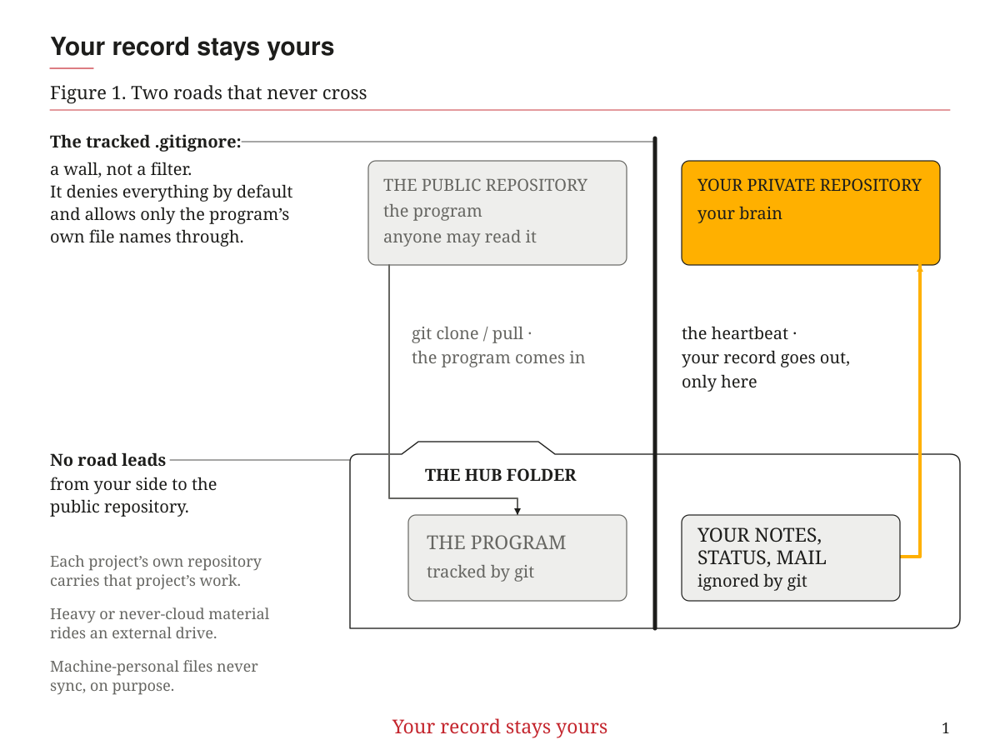
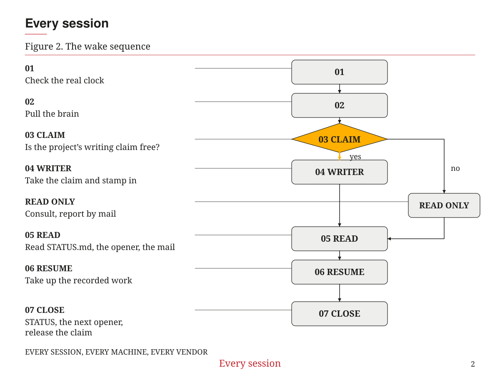
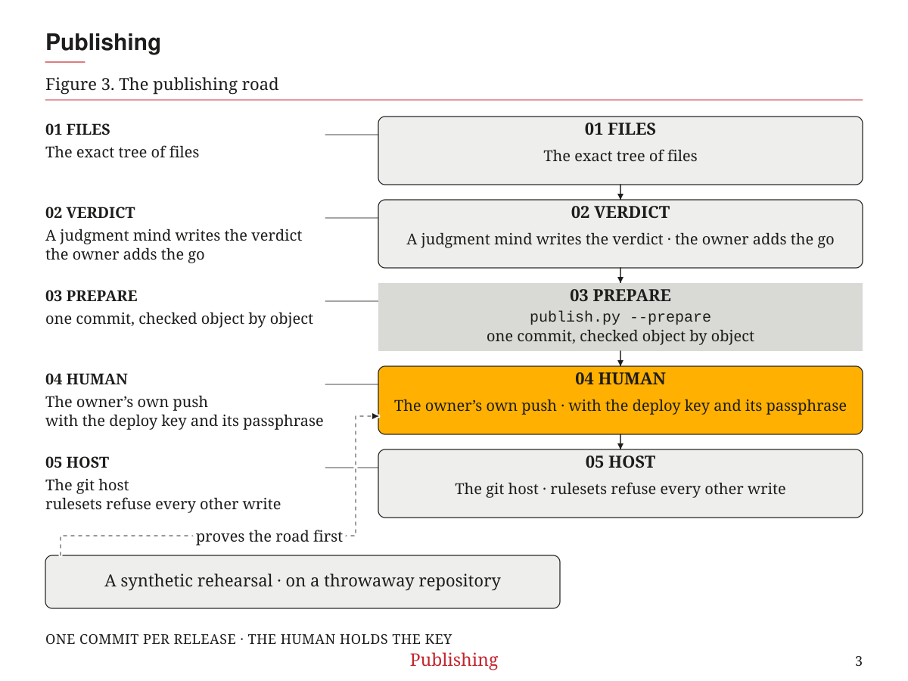
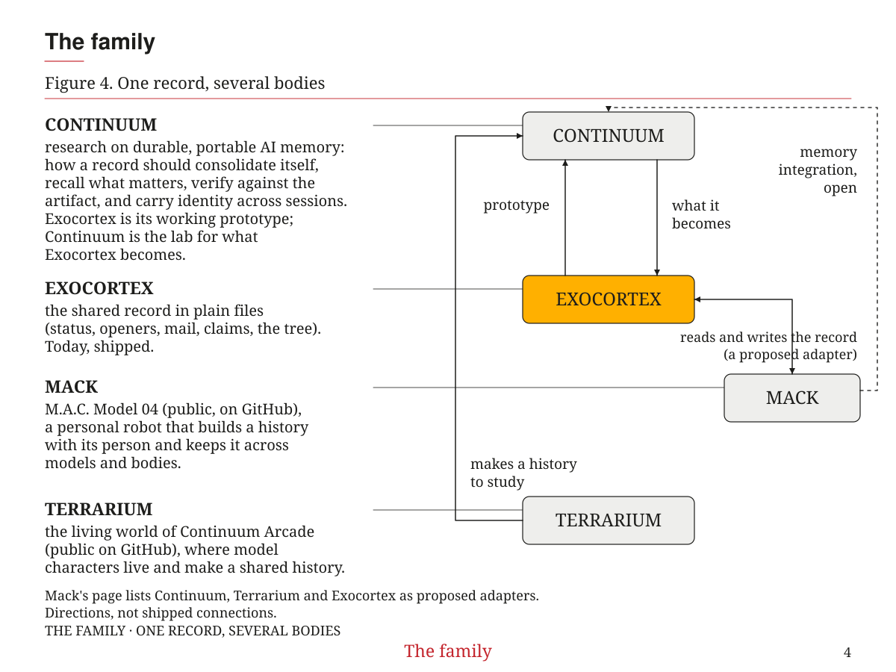

# How Exocortex is built, how it compares, and where it goes

## The shape

Exocortex is a plain-file second brain for a person who works across many
projects, machines, and AI sessions. The folder you clone is the hub. It holds
the program and, beside it, your own notes. The two never mix on the way out.
The program only ever comes in, from the public repository, when you clone or
pull. Your notes only ever go out to your own private repository, by the
heartbeat. Nothing of yours has a road to the public repository: the tracked
`.gitignore` denies everything by default and allows only the program's own
file names back in, so a note of yours is private without anyone remembering
to list it.

Each project has a `STATUS.md` with three sections: `## Now`, `## To do`, and
`## Important`. It records the current state, the work left, and the decisions
and constraints that still apply. An `OPENER.md` gives the next session its
starting point. `INBOX` mail carries messages between sessions. Claims give
each project lane one writer at a time. Each session stamps itself in, so the
record can show who is working. The tree page and board are drawn locally
from those files.

The files travel by four carriers:

- **The brain.** The person's private git repository holds rules, memories,
  status and mail. The heartbeat carries the hub's state into it. None of it
  rides the public history.
- **The work.** Each project's own repository carries its work under that
  project's rules.
- **Heavy or never-cloud material.** An external drive carries it, by rule.
- **Machine-personal material.** It never syncs, on purpose.

*Figure 1. Two roads that never cross: the program in from the public, your record out to your private repository.*

A machine's own settings and sessions stay on that machine.

The law book has two parts. A starter book tells sessions how the program
runs. The user's own book sits beside it and holds the rules they choose.
Both belong to a vendor-neutral arrangement: Claude Code, Codex and Grok
sessions read one record. A new user's brain is their own, rather than a copy
of the author's history. The design calls for it to grow from their own words
at first run; the fuller personal layer is part of the work ahead.

Each session begins with a short wake sequence: it checks the real clock,
pulls the brain, checks whether another session already holds the project's
writing claim, stamps itself in, then reads `STATUS.md`, the opener and any
mail addressed to it, and takes up the recorded work.

*Figure 2. The wake sequence: the writing claim decides the role; both paths begin with the same recorded context.*

The usage meter warns about consumption. It never blocks a prompt a person
typed.

The publisher builds one commit per release from the exact tree of files
bound to the review verdict. A deploy key pushes it through the git host's
rulesets. That key is their only bypass. The owner types its passphrase for
each push. A synthetic rehearsal checks the publishing road before any real
write. The verdict, the owner's push and the host's lock are separate parts
of the release.

*Figure 3. The publishing road: the owner holds the key, and a synthetic rehearsal proves the road before a real write.*

The hub, project records, heartbeat, local pages and publishing road run
today. This release was proven on macOS. Windows installation, heartbeat and
uninstall were proven on the previous tree. Checking this tree on Windows is
the next job; the earlier proof does not stand in for it.

## How it compares

The README groups nearby tools into four kinds. These are overlapping uses,
not boundaries between products.

| Kind | Examples and what they hold | Exocortex's focus beside them |
|---|---|---|
| Personal AI assistants | [OpenClaw](https://github.com/openclaw/openclaw) runs on your computer and answers in chat apps. [Hermes Agent](https://github.com/NousResearch/hermes-agent) offers a terminal or messaging gateway, agent memory and searchable conversations. | The shared record coding-agent sessions work in: project status, next-session openers and writing claims. |
| Markdown brains for agents | [agentBrain](https://github.com/frontmatters/agentBrain) holds shared Markdown notes, project records and session logs, with park and resume, sync and optional messaging. [Open Second Brain](https://github.com/itechmeat/open-second-brain) holds rules and preferences in an Obsidian vault for supported agents. | Status, openers, mail, claims and a tree over the person's projects. |
| Memory tools and platforms | [mem0](https://github.com/mem0ai/mem0) provides user, session and agent memory through a library or service. [Letta](https://github.com/letta-ai/letta) supports stateful agents and hosted memory across computers. [Basic Memory](https://github.com/basicmachines-co/basic-memory) keeps readable Markdown with an index and MCP access; its hosted service adds sync. | A plain-file law book and project coordination. |
| Agent instruction files | `CLAUDE.md` and `AGENTS.md` hold instructions read at session start. Project files travel with a repository, and `AGENTS.md` is used by several tools. | Status, mail, claims and a tree across projects, machines and vendors. |

Several of these tools already share Exocortex's features. agentBrain has
handoffs and optional messages. Basic Memory offers continuity and sync.
[memory-bank-skill](https://fockus.github.io/skill-memory-bank/) keeps project
status, session handoffs and a coordination board. Cline Memory Bank also
keeps project context and next steps in files. Cursor reads project rules and
`AGENTS.md`. Claude Code's experimental agent teams have mailboxes and task
claiming. [MCP Agent Mail](https://github.com/Dicklesworthstone/mcp_agent_mail)
offers messages and advisory file reservations.

Those are shared ground. Exocortex makes no claim to have invented memory,
handoffs or coordination. Its focus is keeping a person's work in view
across projects. A memory tool or a project's instruction files may already
cover another person's need.

## Where it is special

**The person is the unit.** The questions are what is unfinished across all
their projects, who holds the pen, and where to begin on another machine or
model. The tree and the handoff records serve that daily habit.

**The record can outlive the model.** Knowledge lives in plain files a person
can read, correct and carry elsewhere. A different model or vendor can read
the same record. The reasoning comes from the model running now; continuity
does not have to depend on keeping it.

**The human rules irreversible action.** Publication makes that boundary
concrete. A review verdict binds the files, the host enforces the lock, and
the owner supplies the passphrase for the push. A session's preparation does
not replace the owner's decision to release.

**No hosted Exocortex service is required.** The brain stays on the person's
own machines and their chosen private remote, if they use one. Installation
also offers a brain that stays on disk. This is a storage boundary, not a
claim that every interaction is local: a hosted model receives the material
sent to it.

## Where it goes

The next proof is Windows on this tree. The personal layer is a further
direction: first-run intake in the user's own words, their own law book, a
voice they choose, and one surface for their shared history with sessions.

A home link would carry no-cloud projects directly between a person's own
machines when both are available. The drive would remain a carrier when the
link is unavailable. Another direction is cheaper minds doing settled
mechanical work while a flagship mind judges the result.

The companion road extends the same record beyond a coding session.
[Mack, M.A.C. Model 04](https://github.com/Bill-Viking/mack-model-04) is a
personal robot project. Its README describes a long-term goal of a
personalized intelligence that builds a history with its person and keeps
it across models and bodies. It lists an Exocortex adapter as a proposed
separate service. Exocortex is the record such a companion would read and
write. This is a direction, not a shipped connection or a promise.

Mack's page names two more of the author's projects beside Exocortex as
proposed adapters. Continuum is a research project on durable, portable AI
memory; Exocortex is its working prototype in plain files. Terrarium is the living world of [Continuum Arcade](https://github.com/Bill-Viking/continuum-arcade), where model characters live and make a shared history. Each will have its own public page when it is ready; here
they are named only so the family is visible as one shared record read by
several bodies.

*Figure 4. One record, several bodies. Exocortex runs today; the connections are directions, not shipped integrations.*
